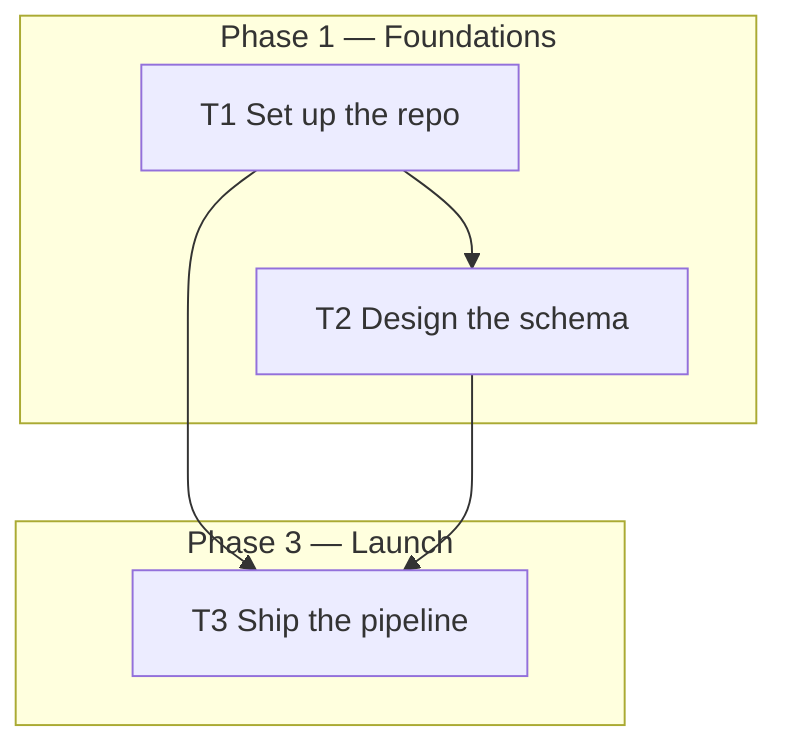

# Pocket CRM

Stage: planning · Plan: draft, version 3

## Score

**Total: 72 / 100** — Promising

| Parameter | Weight | Score | Confidence |
| --- | ---: | ---: | ---: |
| Problem severity | 20 | 7 / 10 | 70% |
| Uniqueness | 15 | 7 / 10 | 70% |
| Market demand | 20 | 7 / 10 | 70% |
| Value | 20 | 7 / 10 | 70% |
| Feasibility | 15 | 7 / 10 | 70% |
| Timing | 10 | 7 / 10 | 70% |

## Spec

### Problem
Freelancers lose track of leads.

### Core features
- Pipeline
- Reminders

## Plan

### Phase 1 — Foundations

**Goal:** Goal of Foundations

**Exit criteria:** Foundations is done

#### T1 — Set up the repo

- Estimate: 3 points
- Labels: chore, server

> Create it.
>
> Then push.

#### T2 — Design the schema

- Estimate: 5 points
- Blocked by: T1 — Set up the repo (phase 1)

### Phase 2 — Quiet phase

**Goal:** Goal of Quiet phase

**Exit criteria:** Quiet phase is done

No tasks in this phase.

### Phase 3 — Launch

**Goal:** Goal of Launch

**Exit criteria:** Launch is done

#### T3 — Ship the pipeline

- Estimate: 8 points
- Labels: feature
- Blocked by: T1 — Set up the repo (phase 1); T2 — Design the schema (phase 1)
